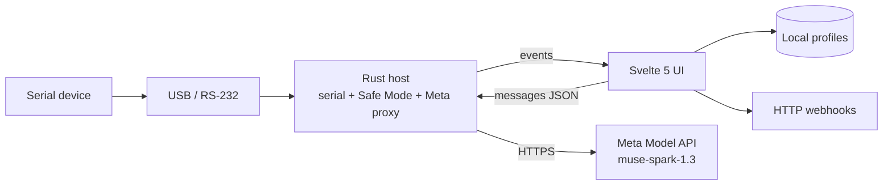

<div align="center">

# SerialBridge

**Desktop gateway for undocumented industrial serial — discover ports, decode protocols, gate writes, stream structured data.**


</div>

---

## Problem

Legacy scales, PLCs, and sensors speak proprietary serial frames. Integrating them usually means a protocol expert, a serial sniffer, and custom glue code. SerialBridge lets **muse-spark-1.3** (Meta Model API) propose parsers and commands, while a **Rust commit gate** and **Safe Mode** decide what may touch the wire.

## Judge path (no hardware)

Pitch video (English, max 3 minutes): [docs/JUDGE_DEMO.md](docs/JUDGE_DEMO.md). Groqbot generate prompt (VO, animation, SRT): [docs/PITCH_VIDEO_GROKBOT.md](docs/PITCH_VIDEO_GROKBOT.md).

1. `npm run tauri dev`
2. Settings → paste Meta Standard key (`LLM_…` from [dev.meta.ai](https://dev.meta.ai)) → Save
3. Follow the script: Demo Mode → Modbus → Investigate → Naive contrast → Prompt injection trap

## Architecture



- **Trust boundary:** serial I/O, webhook HTTP, API keys, and Safe Mode policy live in `src-tauri/`. The WebView does not hold the Meta key or call `api.meta.ai` directly.
- **Verified vs naive:** **Investigate** runs the tool loop and **verified** commit gate. **Naive (no gate)** is a deliberate contrast lane.

## Development

Requirements: Node 20+, Rust stable, platform serial drivers.

```bash
npm ci
npm run dev          # UI only — no serial, no Meta proxy
npm run tauri dev    # full desktop app
```

Verification (matches CI):

```bash
npm run check
npm test
npm run build
```

From `src-tauri/`:

```bash
cargo fmt --all -- --check
cargo clippy --all-targets -- -D warnings
cargo check --all-targets
cargo test
```

## Project layout

```
src/           SvelteKit front end (static adapter)
src-tauri/     Rust host, serial I/O, Safe Mode, Meta API proxy
presets/       Shipped device presets (CAS scale)
tests/         Vitest unit tests
docs/          Judge demo, release, Safe Mode notes
```

## License

MIT — see [LICENSE](LICENSE).
