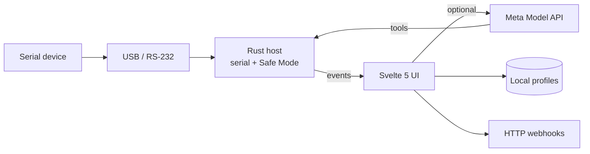

<div align="center">

# SerialBridge

**Desktop gateway for legacy serial devices — discover ports, decode protocols, stream structured data.**


</div>

---

## What it does

SerialBridge connects RS-232 / USB-serial hardware to a modern desktop UI:

- **Port discovery** — list and open serial devices from a Tauri + Rust host
- **Live buffer** — hex and ASCII views of the inbound stream
- **Protocol analysis** — optional AI-assisted identification (Meta Model API, `muse-spark-1.3`) with regex fields for dashboards
- **Agent investigation** — multi-step tool loop for unknown binary or ASCII protocols
- **Safe Mode** — Rust-side gate with human approval before bytes are written to a port
- **Profiles** — save learned protocol definitions locally
- **Webhooks & export** — forward structured readings or save captures

The AI features are **opt-in**: they run only when you add a Meta Model API Standard key in Settings (`LLM_…` from [dev.meta.ai](https://dev.meta.ai)). No vendor keys are bundled in the app.

---

## Architecture



Trust boundary: device access, filesystem, and policy enforcement live in `src-tauri/`. The UI calls explicit Tauri commands only.

---

## Development

Requirements: Node 20+, Rust stable, platform serial drivers.

```bash
npm ci
npm run dev          # UI in browser (no hardware)
npm run tauri dev    # full desktop app
```

Verification (matches CI):

```bash
npm run check
npm test
npm run build
```

From `src-tauri/`:

```bash
cargo fmt --all -- --check
cargo clippy --all-targets -- -D warnings
cargo check --all-targets
```

Copy `.env.example` to `.env` for local `VITE_META_MODEL_API_KEY` during development. Never commit `.env`.

---

## Project layout

```
src/           SvelteKit front end (static adapter)
src-tauri/     Rust host, serial I/O, Safe Mode
presets/       Shipped device presets
tests/         Vitest unit tests
docs/          Release and Safe Mode notes
```

---

## License

MIT — see [LICENSE](LICENSE).
